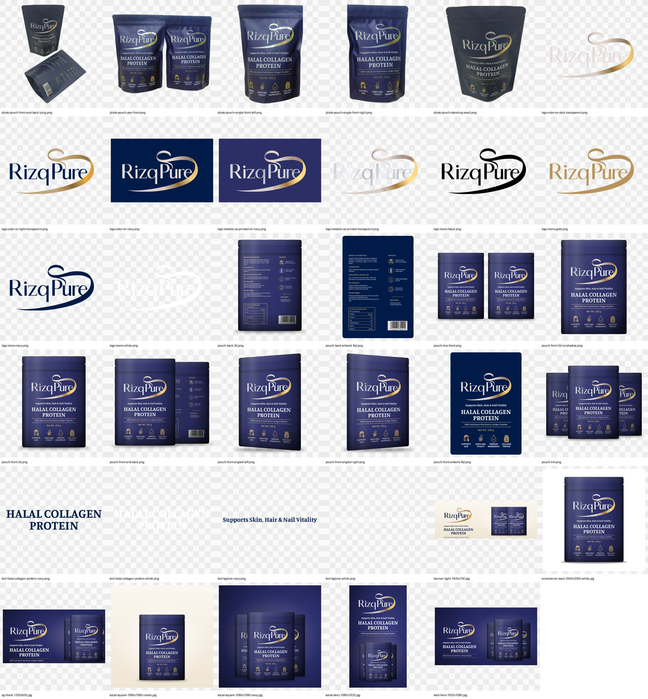

# RizqPure – Halal Collagen Protein · Brand & Product Assets

Generated from the original CorelDRAW print artwork (`_source/original-print-artwork.pdf`).
The dieline/dimension guides were removed and the true vector shapes extracted, so logos and
pouch artwork are **real vectors** (infinitely scalable), not traced images.

## Folders

| Folder | What it is | Use it for |
|---|---|---|
| `svg/` | Master vector files (transparent unless they have a background) | Website, designers, Canva/Figma/Illustrator, any size |
| `pdf-vector/` | Vector PDFs of the logos and pouches | Printers, Illustrator/CorelDRAW, flyers, banners |
| `png-transparent/` | High-res PNGs with transparent background (2400–4000 px) | Website, Shopify/Amazon, social posts, slides |
| `marketing-png-jpg/` | Ready-made layouts at exact platform sizes (PNG + JPG) | Website hero, Instagram/Facebook, link previews, store listing |
| `photo-cutouts/` | Your real product photos with the background removed (transparent PNG) | Anywhere you want the genuine pouch; best at small–medium sizes |

### Print-accurate look

The 3D pouches and marketing layouts are colour-matched to photos of the **printed** pouch, not the
screen colours in the print file: matte indigo film (`#2C2F66` instead of the file's `#011B48`),
metallic-silver wordmark, silver→gold ribbon, soft matte lighting with a pillowed shape and fine film grain.
The flat artwork files and standard logos keep the original file colours.

## Variations

**Logo** – `logo-color-on-dark-transparent` (original colours, for dark backgrounds) ·
`logo-color-on-light-transparent` (navy wordmark + deeper gold ribbon, for white/light backgrounds) ·
`logo-color-on-navy` · `logo-metallic-as-printed-transparent` / `-on-navy` (silver foil look, as on the real pouch) · `logo-mono-white` · `logo-mono-navy` · `logo-mono-gold` · `logo-mono-black`

**Pouch** – `pouch-front-3d` (with floor shadow) · `pouch-front-3d-no-shadow` · `pouch-back-3d` ·
`pouch-front-angled-left` / `-right` (PNG only) · `pouch-duo-front` · `pouch-front-and-back` · `pouch-trio` ·
`pouch-front-artwork-flat` / `pouch-back-artwork-flat` (exact print artwork, no shading)

**Real photo cutouts** – `photo-pouch-pair-front`, `photo-pouch-single-front-left` / `-right`,
`photo-pouch-front-and-back-lying`, `photo-pouch-standing-small` (from your supplier photos; upscaled 2×,
so they're limited by the original photo resolution — use under ~800 px wide)

**Type lockups** (the pack's own lettering) – `text-halal-collagen-protein-white/navy`, `text-tagline-white/navy`

**Marketing layouts** – `web-hero-1920x1080` · `banner-light-1920x700` · `social-square-1080x1080-navy` ·
`social-square-1080x1080-cream` · `social-story-1080x1920` · `og-share-1200x630` (link preview) ·
`ecommerce-main-2000x2000-white` (pure-white store main image)

## Brand colours (sampled from the artwork)

| Colour | HEX |
|---|---|
| Navy (print file) | `#011B48` |
| Indigo (as printed, matte) | `#2C2F66` |
| Gold (icons) | `#B3935F` |
| Bright gold (Net Wt.) | `#EEBC6A` |
| Wordmark off-white | `#E4DDDB` |

## Notes

- The **barcode on the back artwork is the placeholder `1 234567 789012`** from the print file.
  Replace it with your real GTIN before using the back image on a store listing.
- The 3D pouches are drawn artwork with vector shading, not photos — good for websites and ads.
  For hero photography, the real-pouch photos still work best alongside these.
- To regenerate: in `_source/`, run `pdftocairo -svg original-print-artwork.pdf art.svg`, `python3 make_clean.py`, then `python3 build.py out` builds the SVGs; `batch.js` / `pdf.js` / `angle.js`
  render PNG/PDF via Playwright Chromium.
